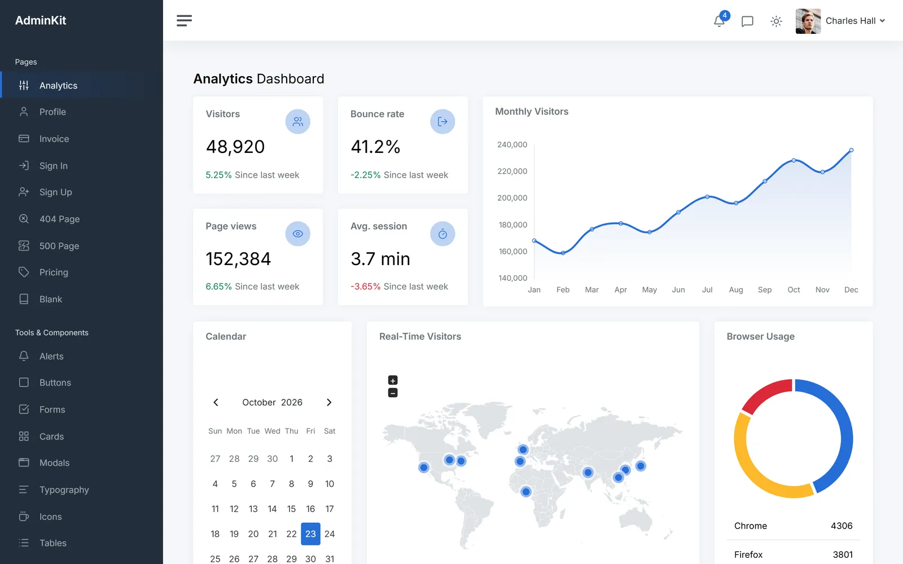

<p align="center">
  <a href="https://github.com/adminkit/adminkit-nextjs"></a>
</p>

<h3 align="center">AdminKit for Next.js</h3>

<p align="center">
  AdminKit is a free & open-source Next.js dashboard & admin template based on Bootstrap 5.
</p>

<p align="center">
  <a href="https://github.com/adminkit/adminkit-nextjs/blob/main/LICENSE"></a>
  <a href="https://github.com/adminkit/adminkit-nextjs/issues?q=is%3Aopen+is%3Aissue"></a>
  <a href="https://github.com/adminkit/adminkit-nextjs/issues?q=is%3Aissue+is%3Aclosed"></a>
  <br>
<a href="https://github.com/adminkit/adminkit-nextjs"></a>
</p>

## Preview

A professional admin and dashboard template built with Next.js, React, TypeScript and Bootstrap 5, with a dashboard, pages, forms, tables, charts and icons. Free and [MIT-licensed](LICENSE).

<picture>
  <source media="(prefers-color-scheme: dark)" srcset=".github/screenshots/dashboard-dark.webp">
  
</picture>

## Features

- **Next.js App Router:** React 19 and strict TypeScript, exported as static HTML you can host anywhere.
- **No Bootstrap JavaScript:** dropdowns, modals, alerts and the sidebar sheet are React components on Bootstrap's markup and classes.
- **Dark mode:** light, dark and auto, built on Bootstrap's color modes, without a flash on load.
- **Accessible:** targets WCAG 2.2 AA in light and dark mode.
- **Fully responsive:** the sidebar turns into an off-canvas sheet on small screens.
- **Modern tooling:** Sass, ESLint, Prettier and Playwright tests that check every page with axe.

## AdminKit and AdminKit PRO

Need more? [AdminKit PRO](https://adminkit.io/pricing/) adds more pages, dashboards and plugins, AI features and a settings panel.

<!-- stats:start -->

|                       | AdminKit      | [AdminKit PRO](https://adminkit.io/pricing/) |
| --------------------- | ------------- | -------------------------------------------- |
| Pages                 | 20            | 53                                           |
| Dashboards            | 1             | 5                                            |
| Plugins               | 4             | 11                                           |
| Icons                 | 2,015         | 4,178                                        |
| Sidebar color schemes | 1             | 3                                            |
| Dark mode             | ✔             | ✔                                            |
| AI features           |               | ✔                                            |
| Settings panel        |               | ✔                                            |
| Support               | GitHub issues | Email                                        |
| License               | MIT           | Commercial                                   |

<!-- stats:end -->

## Quick start

Clone the repository and install the dependencies (Node.js 24):

```sh
git clone https://github.com/adminkit/adminkit-nextjs.git
cd adminkit-nextjs
npm install
```

Start the development server on http://localhost:3000:

```sh
npm run dev
```

Build the static site into `out/`, and serve it with `npm start`:

```sh
npm run build
```

## Documentation

[Customization](https://adminkit.io/docs/getting-started/customization/), [dark mode](https://adminkit.io/docs/getting-started/dark-mode/), [icons](https://adminkit.io/docs/icons/lucide-icons/), [animations](https://adminkit.io/docs/getting-started/animations/), [accessibility](https://adminkit.io/docs/getting-started/accessibility/) and every component are documented at [adminkit.io/docs](https://adminkit.io/docs/).

## Browser support

| <br/>Edge | <br/>Firefox | <br/>Chrome | <br/>Safari | <br/>iOS Safari |
| --------------------------------------------------------------------------------------------------------- | ------------------------------------------------------------------------------------------------------------------ | --------------------------------------------------------------------------------------------------------------- | --------------------------------------------------------------------------------------------------------------- | --------------------------------------------------------------------------------------------------------------------------- |
| 111+                                                                                                      | 111+                                                                                                               | 111+                                                                                                            | 16.4+                                                                                                           | 16.4+                                                                                                                       |

## Resources

- [Website](https://adminkit.io/)
- [Documentation](https://adminkit.io/docs/)
- [Support](https://adminkit.io/support/)
- [Affiliate Program](https://adminkit.io/affiliate-program)

To report a bug or request a feature, [open a new issue](https://github.com/adminkit/adminkit-nextjs/issues/new).
